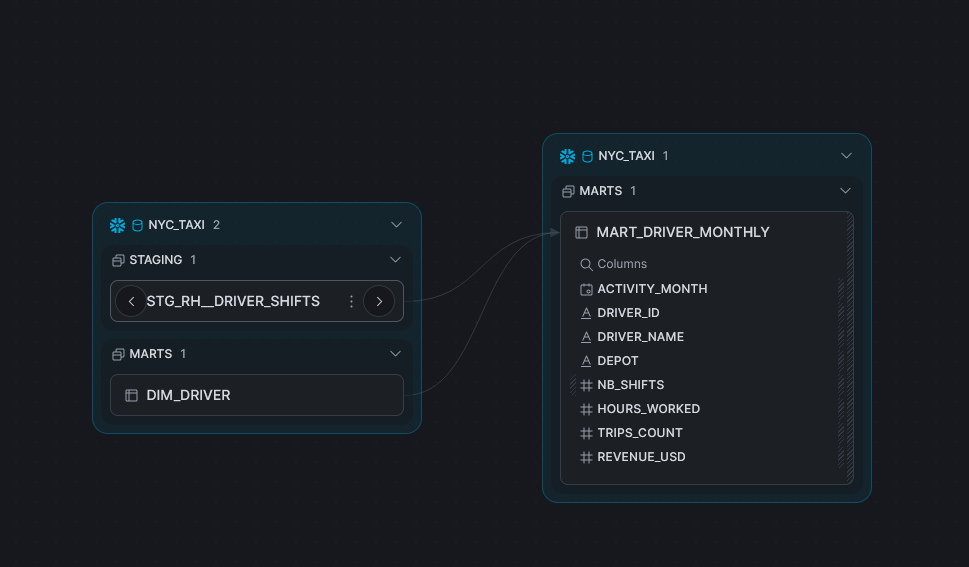
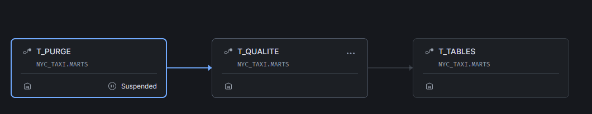

# hudson-cab-gouvernance

Ce dépôt contient la gouvernance de l'entrepôt Snowflake pour les données du personnel de Hudson Cab Partners, c'est-à-dire les chauffeurs. On y trouve le catalogue, le contrôle des accès, la conservation et la qualité de ces données.

Tout le travail répond à une question : **qui peut voir quelle donnée, pendant combien de temps, et peut-on s'y fier ?**

## Arborescence
```
CONTRAT_GOUVERNANCE.md      règles imposées (référence, non modifiée)
GUIDE_BRIEF_GOUVERNANCE.md  guide étape par étape
data/                       fichiers RH, non versionnés (.gitignore)
exemples/                   exemples commentés du kit (bac à sable)
snowflake/
  00_installation.sql
  gouvernance/              rôle de gouvernance, tags, rôles métier, masquage, accès par dépôt,
                            cahier de tests exécutable, référentiel qualité, audit
  rh/                       chargement, staging, marts (SQL de Priya), catalogue/, controles/,
                            purge, conservation, tâches planifiées
docs/                       VEILLE.md, REGISTRE.md, ACCES.md, captures/
```

## Gouvernance

### Ce qui est protégé, et comment

**Qui voit quoi.** Quatre rôles métier lisent le schéma `MARTS`, et lui seul : `RH_PAIE`, `RESP_DEPOT_QUEENS`, `RESP_DEPOT_BRONX` et `ANALYSTE`. Deux politiques de masquage, `MASK_TEXTE` et `MASK_DATE`, sont attachées au tag `DONNEE_PERSONNELLE`. Elles protègent donc toute colonne qui porte ce tag, dans `RAW` comme dans `MARTS`, y compris `driver_name`. La politique d'accès par ligne `RAP_DEPOT` filtre `DIM_DRIVER` et `MART_DRIVER_MONTHLY` par dépôt, d'après la table de correspondance `GOUVERNANCE.ACCES_DEPOT`. Le masquage s'applique par défaut : un rôle absent de la matrice (`ACCOUNTADMIN`, `SYSADMIN`, `GOUVERNANCE`) ne voit aucune valeur personnelle et aucune ligne de `MARTS`. Les scripts sont `snowflake/gouvernance/02` à `04`, et le cahier de tests de `docs/ACCES.md` passe à 37 sur 37.

**Pendant combien de temps.** La règle R1 purge chaque jour, dans les quatre tables, les chauffeurs partis depuis plus de 5 ans : 46 ont été supprimés le 03/11/2026. R2 limite Time Travel à 1 jour, auquel Snowflake ajoute 7 jours de Fail-safe. R3 vide le stage après chaque chargement. Voir `snowflake/rh/purge_rh.sql`, `conservation_rh.sql` et `taches_rh.sql`.

**Peut-on s'y fier.** Huit règles de qualité sont mesurées chaque jour sur `RAW` et enregistrées dans `QUALITE_RESULTATS`. Si la règle bloquante `service_rattache` dépasse son seuil, `MARTS` n'est pas reconstruit. Le catalogue (descriptions et tags) se lit dans la vue `V_CATALOGUE`, ouverte à tous les rôles métier. Une requête d'audit montre qui a lu quelles colonnes personnelles, et avec quel rôle. Voir `snowflake/rh/controles/`, `gouvernance/regles_qualite.sql`, `rh/catalogue/` et `gouvernance/06_audit.sql`.

Les pouvoirs sont séparés. `GOUVERNANCE` écrit les règles mais n'a aucun `SELECT` sur les données. `TRANSFORMER`, le rôle des outils, lit tout pour faire tourner le pipeline, mais ne possède ni les politiques ni la table de correspondance. Les rôles métier ne possèdent rien.

### Les données du personnel restent hors du dépôt
Le `.gitignore` exclut les fichiers `data/*.csv`, pour trois raisons. Un dépôt public est lisible par tous. Un fichier du personnel se traite comme un vrai, même fictif (minimisation, art. 5 du RGPD). Et un fichier poussé une fois reste dans l'historique Git. Les documents et le cahier de tests ne recopient aucune valeur du fichier : les exemples sont inventés, et les tests renvoient « clair » ou « masqué » plutôt que la valeur. Aucun secret n'est versionné non plus, la clé privée de connexion à Snowflake reste hors du dépôt.

### Ordre d'exécution des scripts

Chaque script commence par son `USE ROLE`, se termine par une requête de vérification et peut être rejoué.

| # | Script | Rôle | Contrôle |
|---|---|---|---|
| 1 | `snowflake/00_installation.sql` | ACCOUNTADMIN | schémas RAW, STAGING, MARTS |
| 2 | `snowflake/rh/chargement_rh_1_preparer.sql` | TRANSFORMER | stage `RH_STAGE` créé |
| 3 | Dépôt des 2 CSV sur `RH_STAGE` (Snowsight, ou `PUT 'file://…/data/drivers.csv' @NYC_TAXI.RAW.RH_STAGE AUTO_COMPRESS = FALSE`) | TRANSFORMER | `LIST` : 2 fichiers |
| 4 | `snowflake/rh/chargement_rh_2_copier.sql` | TRANSFORMER | 400 / 25 951 lignes, stage vide |
| 5 | `snowflake/rh/00_tables_rh.sql` | TRANSFORMER | 3 tables dans MARTS |
| 6 | `snowflake/rh/staging/stg_rh__drivers.sql`, `stg_rh__driver_shifts.sql` | TRANSFORMER | 25 933 services |
| 7 | `snowflake/rh/marts/dim_depot.sql`, `dim_driver.sql`, `mart_driver_monthly.sql` | TRANSFORMER | 3 / 400 / 914 lignes |
| 8 | `snowflake/gouvernance/01_gouvernance.sql` | ACCOUNTADMIN puis GOUVERNANCE | 3 tags, `QUALITE_RESULTATS` |
| 9 | `snowflake/gouvernance/modele_catalogue_dim_depot.sql`, puis `snowflake/rh/catalogue/catalogue_*.sql` (4 fiches) | TRANSFORMER | aucune colonne sans description |
| 10 | `snowflake/gouvernance/02_roles_metier.sql` | ACCOUNTADMIN | 4 rôles métier |
| 11 | `snowflake/gouvernance/03_masquage.sql` | GOUVERNANCE | 2 politiques sur le tag |
| 12 | `snowflake/gouvernance/04_acces_depot.sql` | GOUVERNANCE | `ACCES_DEPOT`, `RAP_DEPOT` sur 2 tables |
| 13 | `snowflake/gouvernance/05_tests_acces.sql` (un test à la fois, avec le rôle indiqué) | chaque rôle | 37 / 37 verts |
| 14 | `snowflake/gouvernance/regles_qualite.sql` | GOUVERNANCE | 8 règles, 1 bloquante |
| 15 | `snowflake/rh/conservation_rh.sql` | TRANSFORMER | `retention_time = 1` |
| 16 | `snowflake/rh/purge_rh.sql` | TRANSFORMER | 46 supprimés, Time Travel relit 400 |
| 17 | `snowflake/rh/controles/*.sql` | TRANSFORMER | 1 nombre par règle |
| 18 | `snowflake/rh/catalogue/v_catalogue.sql` | TRANSFORMER | `ANALYSTE` lit les 3 tables |
| 19 | `snowflake/rh/taches_rh.sql` | TRANSFORMER | 3 tâches en `SUCCEEDED` |
| 20 | `snowflake/gouvernance/06_audit.sql` | ACCOUNTADMIN | rôles ayant lu les colonnes personnelles |
| — | `snowflake/gouvernance/demo_ajout_depot.sql` (démonstration, bloc par bloc) | ACCOUNTADMIN, GOUVERNANCE | Brooklyn ouvert sans toucher aux politiques |

À la fin du brief, la tâche racine a été suspendue avec `ALTER TASK NYC_TAXI.MARTS.T_PURGE SUSPEND;`, parce qu'une tâche active consomme des crédits chaque jour. Pour relancer la chaîne, il faut réactiver le graphe avec `SELECT SYSTEM$TASK_DEPENDENTS_ENABLE('NYC_TAXI.MARTS.T_PURGE');`.

### Le chargement

Le format de fichier `RAW.CSV_RH` indique à Snowflake comment lire le CSV : le séparateur, la ligne d'en-tête à sauter, les guillemets optionnels. Il conserve les espaces (`TRIM_SPACE = FALSE`) pour que `RAW` reste une copie fidèle du fichier, `BRONX ` compris.

Le stage `RAW.RH_STAGE` est un espace de dépôt interne, chiffré côté serveur. On y pose les fichiers avant de les copier dans une table.

`COPY INTO` lit les fichiers du stage avec ce format et type les colonnes (`$6::date`…). Il ajoute le nom du fichier et l'heure de chargement (`METADATA$FILENAME`, `METADATA$START_SCAN_TIME`) et s'arrête à la première erreur (`ON_ERROR = ABORT_STATEMENT`). Il garde aussi la trace des fichiers déjà chargés. Relancé, il ne charge rien deux fois, ce que nous avons vérifié : `LOAD_SKIPPED`, « File was loaded before ».

`PURGE = TRUE` retire du stage chaque fichier chargé, comme le demande R3. Il y a un cas qu'il ne couvre pas : un fichier redéposé est ignoré par `COPY`, donc il n'est pas purgé. C'est pourquoi un `REMOVE @RH_STAGE` final vide le stage dans tous les cas.

### Choix techniques

| Choix | Pourquoi |
|---|---|
| Masquer les colonnes personnelles de `DIM_DRIVER` et `MART_DRIVER_MONTHLY` plutôt que les supprimer | La même table sert quatre rôles, et la paie a besoin de l'e-mail, de la licence et de la date de naissance. Supprimer ces colonnes les lui retirerait. Avec le masquage, chacun voit la même table à sa façon. Nous avons écarté une vue par rôle, qui aurait multiplié les objets à gouverner. `driver_name` reste, parce que les responsables de dépôt s'en servent, mais il porte le tag `nom` et l'analyste le voit masqué. |
| Le masquage est attaché au tag, pas aux colonnes | Une colonne taguée demain sera protégée sans qu'on touche aux politiques, et le catalogue ne peut pas diverger de la protection. Une seule exception est codée dans la politique : `identifiant_interne` (`driver_id`) reste visible de tous. |
| Une politique par type (`MASK_TEXTE`, `MASK_DATE`) | Une politique renvoie le type qu'elle reçoit. Une date masquée vaut donc `NULL`, et celle de l'analyste devient le 1er janvier de l'année de naissance, ce qui reste une date. |
| Le masque est `'*****'`, mais `NULL` reste `NULL` | Un masque ne doit pas laisser croire qu'un téléphone existe. |
| `MASK_TEXTE` reconnaît les responsables de dépôt à leur nom, `RESP_DEPOT_*` | Pour ouvrir un dépôt, il suffit de créer `RESP_DEPOT_<DÉPÔT>` et d'ajouter une ligne dans `ACCES_DEPOT`. Aucune politique ne change, comme le montre `demo_ajout_depot.sql`. Seul `ACCOUNTADMIN` peut créer un rôle. |
| Dans `ACCES_DEPOT`, `'*'` veut dire tous les dépôts, et `TRANSFORMER` y figure | Sans cette ligne, le pipeline ne verrait aucune ligne de `DIM_DRIVER`, et `MART_DRIVER_MONTHLY` se reconstruirait avec un `driver_name` vide sans lever d'erreur. |
| Les politiques s'appuient sur `CURRENT_ROLE()` | Seul le rôle principal compte, les rôles secondaires n'ouvrent rien de plus (test L3). Conséquence : `ACCOUNTADMIN` a bien le droit de lire, par héritage `SYSADMIN` → `TRANSFORMER`, mais il ne voit aucune ligne de `MARTS` et ne voit dans `RAW` que des valeurs masquées. |
| R1 s'applique aussi aux services (`RAW.DRIVER_SHIFTS`) | Les heures et les recettes d'un chauffeur sont ses données, et R1 vise « partout où la donnée a été copiée ». Si on les gardait, ses services deviendraient orphelins et feraient monter la règle bloquante `service_rattache`. |
| La purge supprime aussi dans `MARTS` | `T_TABLES` ne part pas quand la qualité échoue. Sans purge directe dans `MARTS`, une alerte bloquante y prolongerait la conservation. |
| Les seuils et les gravités sont dans `GOUVERNANCE.QUALITE_REGLES` | Chaque règle est documentée (énoncé, seuil, gravité) là où la tâche la lit. Pour abaisser un seuil, `GOUVERNANCE` fait un `UPDATE`, sans réécrire ni suspendre la tâche. C'est ainsi que nous avons prouvé le blocage. |
| La mesure est enregistrée avant l'erreur bloquante | La trace reste même quand la chaîne s'arrête. |
| Les noms d'utilisateur sont mis entre guillemets (`SET moi = '"' \|\| CURRENT_USER() \|\| '"'`) | `IDENTIFIER()` lit un nom avec des points (`prenom.nom`) comme `base.schéma.objet`. Nous avons corrigé `00_installation.sql` en conséquence. |

### Lignage

`data/drivers.csv` → `RH_STAGE` → `RAW.DRIVERS` → vue `STAGING.STG_RH__DRIVERS` (e-mail en minuscules, dépôt normalisé) → `MARTS.DIM_DRIVER` (ajout de `is_active` et `tenure_years`) → `MARTS.MART_DRIVER_MONTHLY` (`driver_name` = prénom + nom).

`data/driver_shifts.csv` → `RH_STAGE` → `RAW.DRIVER_SHIFTS` → vue `STAGING.STG_RH__DRIVER_SHIFTS` (doublons retirés, de 25 951 à 25 933 services) → `MARTS.MART_DRIVER_MONTHLY` (agrégé par chauffeur, mois et dépôt).

Voici l'onglet *Lineage* de `MART_DRIVER_MONTHLY` dans Snowsight :



Et le graphe des tâches planifiées, avec la racine `T_PURGE` suspendue à la fin du brief :



Les résultats de qualité et d'audit sont recopiés en texte dans [`docs/REGISTRE.md`](docs/REGISTRE.md), partie 2, « Comment on le contrôle ».

### Écarts entre le contrat et les textes
L'analyse complète est dans la section 4 de [`docs/VEILLE.md`](docs/VEILLE.md). En résumé, le RGPD s'applique (art. 3.1), parce que le traitement se fait dans le cadre des activités de Hudson Cab Europe, établie à Paris. Hudson Cab Europe est responsable du traitement, Snowflake (région Paris) est sous-traitant, et l'autorité compétente est la CNIL. Nous signalons les écarts sans réécrire le contrat.

| # | Règle du contrat | Écart | Proposition |
|---|---|---|---|
| 1 | Préambule | Le contrat a été rédigé avant le transfert. Il ne parle ni du RGPD, ni du responsable du traitement, ni de finalité, ni de base légale (art. 4.7, 6, 30). | Faire valider le contrat par Hudson Cab Europe et son DPO. La note propose des finalités et des bases légales. |
| 2 | R1 : 5 ans après la fin du contrat | C'est l'écart principal. Pendant 5 ans, un chauffeur parti reste en base active et apparaît comme un chauffeur en poste (64 sont encore présents après la purge). La CNIL demande qu'après le départ, les données passent en archivage intermédiaire à accès restreint. La durée de 5 ans vient du droit du travail français, alors que New York impose 6 ans pour les relevés de paie. | Retirer les chauffeurs partis de la vue des responsables de dépôt et de l'analyste, soit par un filtre `is_active` dans la politique de lignes, soit par une table d'archive que seul `RH_PAIE` peut lire. Faire trancher la durée par le juriste. |
| 3 | R2 : Time Travel 1 jour | Le Fail-safe ajoute 7 jours qu'on ne peut pas réduire sur une table permanente. La suppression n'est donc effective qu'au bout de 8 jours. | C'est écrit dans le registre. L'autre option serait des tables `TRANSIENT`, qui n'ont pas de Fail-safe. |
| 4 | Matrice des accès | Le dépôt de Brooklyn n'a pas de responsable. `RH_PAIE` voit la date de naissance et la licence sans qu'on ait montré qu'elle en a besoin. Les accès depuis New York sont des transferts hors UE. | Signaler ces points. La table de correspondance permet d'ajouter `RESP_DEPOT_BROOKLYN` sans toucher aux politiques. |
| 5 | Règles de qualité | Les règles mesurent, mais personne n'est chargé de corriger (art. 5.1 d, 16). Au premier passage, 6 règles sur 8 étaient en `ALERTE`. | Désigner le service RH qui reçoit les alertes (bonus : `CREATE ALERT`). |
| 6 | Absent du contrat | Rien sur l'information des chauffeurs, leurs droits d'accès et d'effacement, ni sur les transferts. | Compléter avec le registre (`docs/REGISTRE.md`). |

### Limites connues

- L'analyste ne voit aucun identifiant direct, mais `driver_id`, le dépôt, la date d'embauche et l'année de naissance peuvent ensemble désigner un chauffeur au profil rare. Ses données sont pseudonymisées, pas anonymes. Une politique d'agrégation (bonus 3) réduirait ce risque.
- `TRANSFORMER` voit tout et peut retirer un tag de ses propres tables, ce qui démasque la colonne. Le catalogue rejoué depuis Git, le test n° 12 et l'audit limitent ce risque sans l'empêcher.
- Un rôle nommé `RESP_DEPOT_*` verrait les noms et les téléphones de son dépôt, à condition d'avoir une ligne dans `ACCES_DEPOT`. Seul `ACCOUNTADMIN` peut créer des rôles.
- Les chauffeurs partis restent en base active jusqu'à 5 ans (écart n° 2). Et comme la purge est quotidienne, il peut s'écouler jusqu'à 9 jours entre le 5e anniversaire du départ et la disparition définitive des données, en comptant l'attente de la tâche, Time Travel et Fail-safe.
- `ACCESS_HISTORY` dit qu'une colonne a été lue, pas si elle a été vue en clair, et son contenu peut avoir jusqu'à 3 h de retard.
- Le seuil de `telephone_renseigne` vaut 5 % des chauffeurs en poste, arrondi à 2 décimales, soit 14,50 lignes au 03/11/2026.
